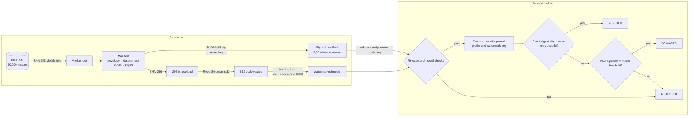
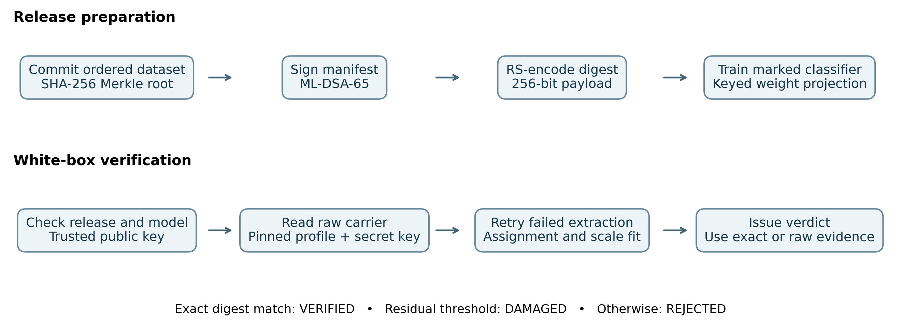
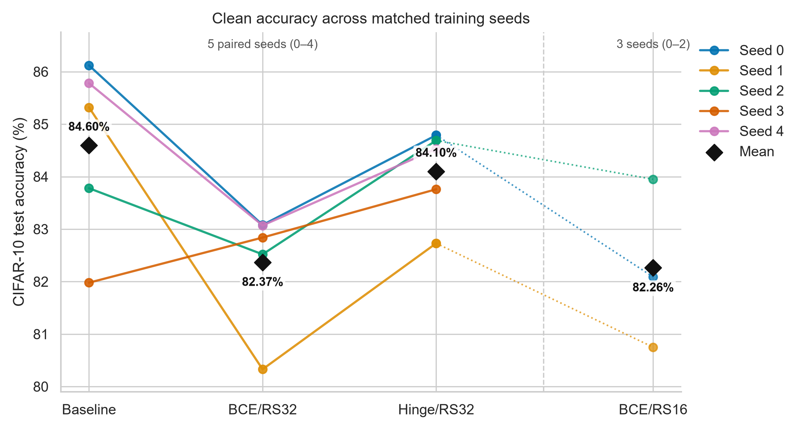
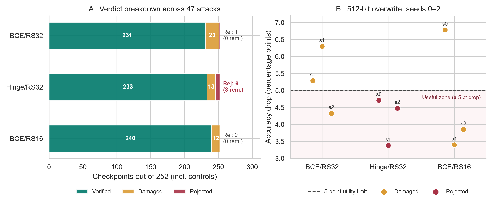
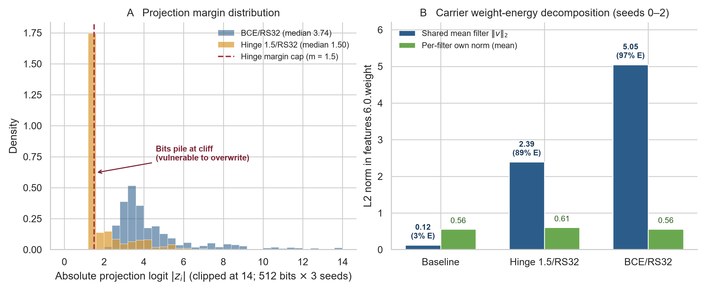
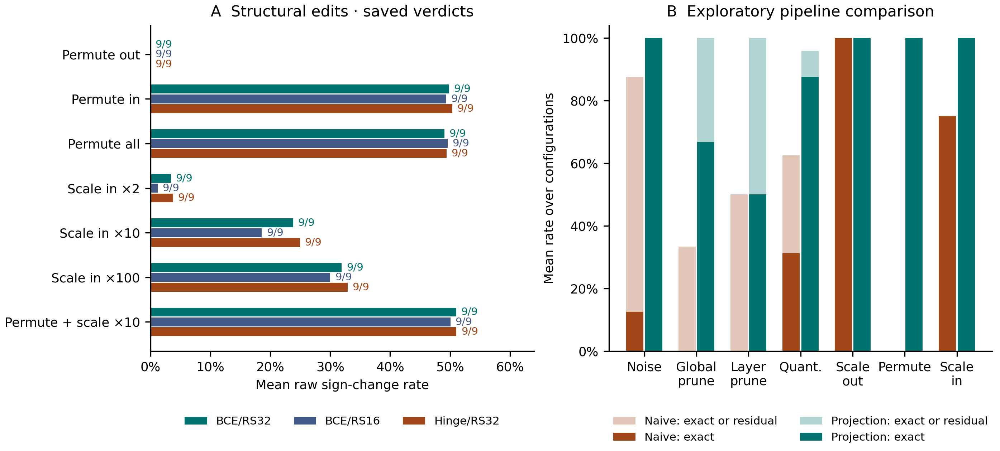
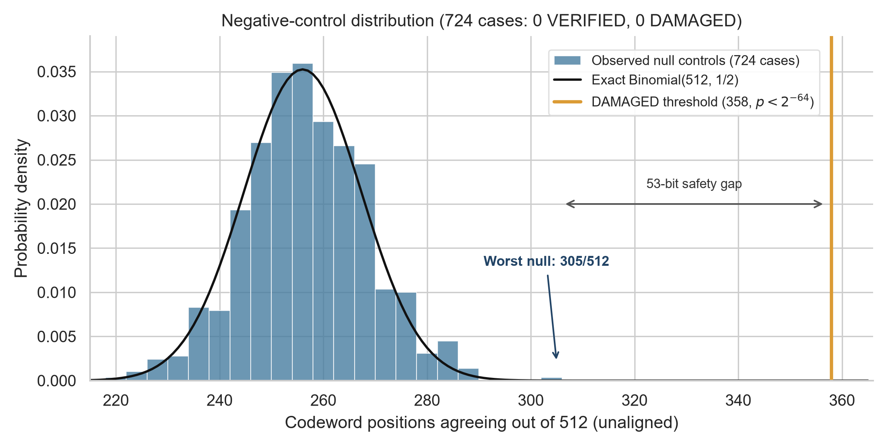
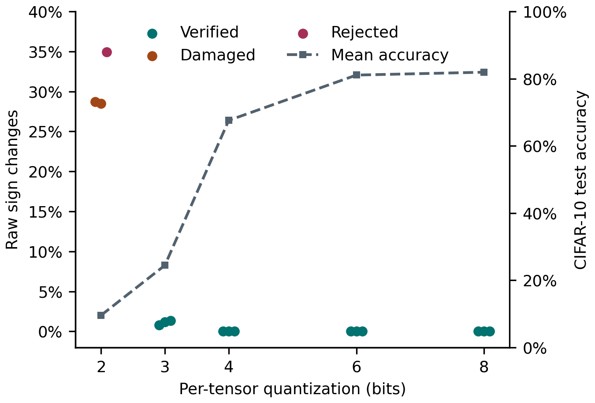
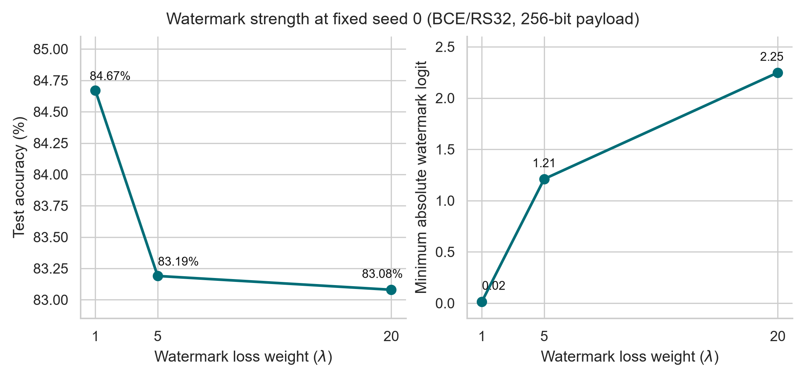

<div align="center">

# Post-Quantum AI Provenance Watermarking

**A white-box classifier watermark linked to an ML-DSA-65 signed manifest.**

[-6f42c1)](https://csrc.nist.gov/pubs/fips/204/final)
[](#quick-start)
[](https://pytorch.org)
[](https://github.com/open-quantum-safe/liboqs-python)
[](#tests)
[](#roadmap)

*A trusted auditor checks the signed record and extracts the keyed weight watermark to report **VERIFIED**, **DAMAGED** or **REJECTED**.*

[How it works](#how-it-works) · [Results](#results) · [Paper & figures](#paper-and-figures) · [Quick start](#quick-start) · [Dashboard](#pqctl-the-control-centre) · [Limitations](#honest-limitations) · [Roadmap](#roadmap)

</div>

---

## At a glance

| | |
|---|---|
| **Post-quantum signature** | The release manifest is signed with **ML-DSA-65** (NIST FIPS 204). |
| **Weight association** | A keyed projection embeds the **256-bit manifest digest**. Verification requires the signed release record and a trusted public key. |
| **Dataset commitment** | A **Merkle root** commits to the ordered **50,000 CIFAR-10 training images** and labels. An optional dataset check recomputes that root. |
| **Error correction** | **Reed-Solomon (rs32)** protects the payload: 256 bits become 512 code values, so damaged bytes can be repaired. |
| **Robustness** | 252 evaluations per design, including controls. BCE/RS32 and BCE/RS16 recorded zero successful removals. Hinge/RS32 recorded three, all under a 512-bit overwrite. |
| **False positives** | No false VERIFIED or DAMAGED verdicts in 724 null cases or in 54 attacked baseline evaluations (778 total controls). |
| **IEEE manuscript** | IEEE-format draft in [`paper1/`](paper1/) with five tables, eight figures, and 17 bibliography entries. |
| **One control centre** | `pqctl`: a local web dashboard and terminal tool that runs every phase, plus interactive labs (Watermark X-ray, Attack lab, Tamper lab, Signing lab). |

---

## Why this exists

AI models get copied, fine-tuned, re-uploaded and passed off as someone else's work. Two problems make that easy:

1. **A signature file next to a model can simply be deleted.** Nothing in the weights says who made them.
2. **Today's signatures will not last.** RSA and elliptic-curve signatures can be forged by a large enough quantum computer running Shor's algorithm. A model signed today with ECDSA could be "re-signed" by anyone in the future.

The prototype signs the manifest with a post-quantum algorithm and embeds its digest in the weights. The signature authenticates the record. Watermark extraction assesses association under the trusted-auditor profile.

> **Actors.** The **Developer** trains, signs and embeds. The **Model** carries the watermark. The **Auditor** extracts and verifies (white-box access to the weights).

---

## How it works



**Step by step:**

1. **Commit to the dataset.** Every raw training image becomes a Merkle leaf, `SHA-256(0x00 | index | label | pixels)`, and the leaves are hashed up to one root. Domain-separated leaf and node hashes, and the index inside each leaf, mean images cannot be swapped, re-labelled or edited without changing the root.
2. **Write and sign a manifest.** A canonical JSON record (developer id, dataset root, architecture, parameter count, key id) is signed with **ML-DSA-65**.
3. **Derive the payload.** `payload = SHA-256(canonical manifest bytes)`, all 256 bits of it. A change to the serialized manifest changes the input to SHA-256.
4. **Embed it.** The carrier vector `v` is one conv layer's weights averaged over output filters (576 numbers). A secret ±1 matrix `X`, expanded with SHAKE-256 from the **watermark key**, turns `v` into 512 scores. Training adds `λ · BCE(sigmoid(X·v), codeword)` to the usual cross-entropy, in the style of Uchida et al.
5. **Verify.** The auditor checks the signature, rebuilds the model at the signed width, checks the parameter count and that the weights are finite, reads the 512 scores, repairs them with Reed-Solomon, and requires **all 256 bits** to equal `SHA-256(signed manifest)`. A decoder saying "ok" is never enough on its own.

> **Why ECC?** The sign of each score is one bit and its size is the confidence. The decoder uses that: the least confident bytes are marked as *erasures*, which cost half as much to repair as errors (soft decoding).

---

## Results

The Phase 7 report combines the saved SmallCNN runs, verifier verdicts, and accuracy measurements. [Results and methods](docs/phase7_results.md)

### Accuracy cost of the watermark

SmallCNN (160,234 parameters) on CIFAR-10, 30 epochs, accuracy differences paired by seed:

| Model | Test accuracy | Change vs baseline |
|---|---:|---:|
| Baseline (seeds 0–4) | 84.60% | — |
| BCE/RS32 (seeds 0–4) | 82.37% | −2.23 pts |
| Hinge 1.5/RS32 (seeds 0–4) | 84.10% | −0.50 pts |
| BCE/RS16 (seeds 0–2) | 82.26% | −2.81 pts |
| BCE/rep2 (seeds 0–1) | 81.52% | −4.20 pts |

Every chosen-design model decodes with **0 bit errors** after correction (minimum margin 2.24 for BCE/RS32, 2.70 for BCE/RS16, 1.50 for Hinge 1.5/RS32). The shared mean-filter norm was **5.05** for BCE/RS32 (97% of layer energy) and **2.39** for Hinge 1.5/RS32 (88–89%) on seeds 0–2. These carrier measurements accompany the +1.73-point paired hinge accuracy gain.

### Robustness across designs (252 evaluations each, seeds 0–2)

A successful removal requires a REJECTED verdict and a test accuracy drop of at most five percentage points from the clean model. DAMAGED requires raw agreement of at least 358/512 for RS32 or 280/384 for RS16 after exact recovery fails. Each threshold has a tail below 2⁻⁶⁴ for a prespecified comparison with independent, fair hard decisions. The tail does not describe the full verifier.

| Design | Verified | Damaged | Rejected | Successful removals | Failure mode |
|---|---:|---:|---:|---:|---|
| **BCE / RS32** | 231 | 20 | 1 | **0** | 2-bit quantization (8.58% for the rejected copy) |
| **BCE / RS16** | 240 | 12 | 0 | **0** | None (even exact VERIFIED on 128-bit overwrite) |
| **Hinge 1.5 / RS32** | 233 | 13 | 6 | **3** | `overwrite_512bit` (acc drops 3.38–4.71 pts) |

Across three trained checkpoints per design, **108** permutation or combined permutation + ×10 input-scale evaluations and **81** input-scaling-only evaluations verified exactly with no recorded accuracy change. Output-side rescaling was evaluated separately.

### Attack-by-attack breakdown (BCE/RS32)

| Attack family | Strongest setting that still verified | Outcome |
|---|---|:---:|
| Gaussian noise (all weights) | σ = 0.5 × weight spread (accuracy falls to 44%) | ✅ held |
| Noise aimed at the watermark layer | σ = 1.0 (accuracy 56%) | ✅ held |
| Global magnitude pruning | 70% of weights deleted (model already useless) | ✅ held |
| Quantization, per tensor | **3 bits**, hard RS repaired 5.33 bytes on average | ✅ held |
| float16 round trip | exact | ✅ held |
| Fine-tuning | 10 epochs on the **full** dataset, lr 0.05 | ✅ held |
| Prune 50% + fine-tune | 3 epochs | ✅ held |
| Channel rescaling (function-preserving) | ×10 on every layer | ✅ held |
| Shuffle the carrier's **output** channels | all 9 runs | ✅ held |
| Shuffle the carrier's **input** channels (removed it in Phase 6) | 9/9 exact with extraction retries available | ✅ held |
| Rescale the carrier's input channels (new in 6b) | ×100, and shuffle + ×10 | ✅ held |
| Overwrite with a second watermark, 128 or 512 bits (removed it in Phase 6) | exact payload lost and residual threshold met | ✅ traced (DAMAGED) |

**Totals (Phase 6b verifier):** **231 / 252** evaluations including clean controls verified exactly, **20** more traced as DAMAGED, **1** rejected (2-bit quantization, 8.58% accuracy for the rejected copy) · **0 successful removals** (Phase 6 had 4 attack types) · **0 / 54** false accepts on unmarked models, plus **0 / 724** in the false-accept stress test. Full tables: [`docs/phase6b_results.md`](docs/phase6b_results.md) (now) and [`docs/phase6_results.md`](docs/phase6_results.md) (before the defence).

**Phase 6b extraction retries.** After a failed raw read, the verifier may try channel assignment and positive-scale fitting, then checks for the exact digest. Cover’s count gives a conditional probability bound for strict sign fitting with a fixed channel order and independent uniform labels. It serves as an eligibility rule. A bound for the implemented assignment and decoder remains open. See the [manuscript methods](paper1/method.tex) for the extraction profile and the two null models.

<details>
<summary><b>Show the eight manuscript figures</b></summary>

| | |
|:---:|:---:|
|  |  |
| **End-to-end protocol architecture** | **Paired CIFAR-10 accuracy (5 seeds)** |
|  |  |
| **252-checkpoint verdicts & 512-bit overwrite** | **Shared-filter norm and energy** |
|  |  |
| **Obfuscation recovery & naive vs projection** | **724 RS32 extraction controls** |
|  |  |
| **RS32 error correction & accuracy under quantization** | **Watermark strength sweep (seed 0)** |

</details>

### Why post-quantum costs bytes

| Scheme | Public key | Signature | Quantum-safe |
|---|---:|---:|:---:|
| RSA-2048 | 256 B | 256 B | ❌ |
| ECDSA P-256 | 64 B | 64 B | ❌ |
| Ed25519 | 32 B | 64 B | ❌ |
| **ML-DSA-65 (this project)** | **1,952 B** | **3,309 B** | ✅ |

That size is why the design hides only a 256-bit *fingerprint* of the manifest in the weights and ships the full signature next to the model.

---

## Quick start

### 1. Install

```bash
git clone https://github.com/shield44-project/post-quantum-cryptography.git
cd post-quantum-cryptography
python -m venv venv && source venv/bin/activate        # Windows: venv\Scripts\activate

pip install torch torchvision --index-url https://download.pytorch.org/whl/cpu
pip install -r requirements.txt
```

**liboqs-python** (ML-DSA) is built from source:

```bash
sudo apt install -y git cmake ninja-build build-essential libssl-dev   # Fedora: dnf install the same tools
git clone --depth=1 https://github.com/open-quantum-safe/liboqs-python
pip install ./liboqs-python
python tests/test_mldsa.py                                            # prints: correct message: True
```

> On native Windows, see *Setup: liboqs on native Windows* in [`docs/phase_commands.md`](docs/phase_commands.md).
> Obtain the public key independently from the trusted release owner. The historical watermark key is distributed separately to authorized auditors.

### 2. Verify a model

The saved run transcript below uses the project-generated sidecar. For an externally supplied checkpoint, pin the extraction settings explicitly or use a trusted sidecar, and leave the legacy short-payload override disabled.

```console
$ python -m verify.verify_model --model runs/wm_v1/lam20_n256_rs32/seed0/model.pt
watermark settings (final.json): ecc rs32 | n_bits 256 | layer features.6.0.weight | mode mean
PASS  load release files
PASS  key id matches manifest  (manifest=bae58d20d2964be6ef068a9ff17772af key=bae58d20d2964be6ef068a9ff17772af)
PASS  algorithm is ML-DSA-65
PASS  signature valid
PASS  payload.hex matches manifest
PASS  architecture is SmallCNN  (manifest says 'SmallCNN')
PASS  model loads at signed width 32
PASS  parameter count matches manifest  (model 160234, manifest 160234)
PASS  weights are finite numbers
PASS  watermark read (ecc rs32, 512 values)  (min margin 2.25, corrected 0, erasures 0)
PASS  extracted payload == SHA-256(signed manifest)  (256 bits match)
VERIFIED
```

Try it on an unmarked model and it is rejected:

```bash
python -m verify.verify_model --model runs/baseline/seed0/model.pt      # REJECTED
```

For scripts and CI, `--json` prints one machine-readable object, and the exit code is `0` only for VERIFIED:

```bash
python -m verify.verify_model --json --model path/to/model.pt | jq .verdict
```

### 3. Re-prove everything

```bash
python -m pqctl pipeline check-all     # ~1-5 min: every test, signature, tamper demo, watermark, negative case
```

---

## pqctl: the control centre

A **standard-library-only** dashboard and CLI that runs every phase of the project, streams live logs and shows the results.

```bash
python -m pqctl serve        # opens http://127.0.0.1:8765
python -m pqctl              # interactive terminal menu
```

| Page | What you get |
|---|---|
| **Home** | Headline numbers, results charts, phase board, one-click pipelines |
| **Watermark X-ray** | The 576 carrier numbers as a heatmap, a histogram of the 512 scores, every code value before repair, the Reed-Solomon repair, and the 256 payload bits against the signed record. Read with our key, Mallory's key or a random key |
| **Attack lab** | Play the thief: pick any attack and strength, damage a copy, and watch which bits flip and whether it still verifies, next to what Phase 6 measured |
| **Tamper lab** | Play the forger: edit the developer, width, dataset root, signature or key, and see the fingerprint change live in the browser before verifying |
| **Signing lab** | ML-DSA-65 on any text with a throwaway key pair, with timings and size comparisons |
| **Hash and Merkle** | A live SHA-256 avalanche demo and an 8-leaf Merkle tree you can edit |
| **Release and keys** | The signed manifest, the exact signed bytes, key ids, fingerprints and the frozen model hashes |
| **Test model** | 11 live tests with expected results, including the two known weaknesses |
| **Phases 0-7** | Every step with its options, the exact command, a **Run** button and a **Colab cell** button for GPU steps |

**Built safe:** listens on `127.0.0.1` only · per-session token on every POST · Host and Origin checks · files under `keys/` are never served · only steps defined in `pqctl/tasks.py` can run (no free-form commands) · overwriting keys or the release requires typing `OVERWRITE`.

```bash
python -m pqctl run lab.xray --set model=runs/baseline/seed0/model.pt
python -m pqctl run lab.attack --set attack=prune_global --set strength=0.5
python -m pqctl run lab.tamper --set developer_id=Mallory
python -m pqctl colab p4.train                     # a ready-to-paste Colab cell for a T4 GPU
```

Full guide: [`docs/PQCTL.md`](docs/PQCTL.md).

---

## Negative cases: what must be rejected

`python -m experiments.phase5_negative_cases` runs 8 cases per seed, and each must fail **for the right reason**:

| Case | Expected | Stops at |
|---|:---:|---|
| Our model + our files | ✅ VERIFIED | — |
| Wrong public key | ❌ REJECTED | key id check |
| Wrong watermark key | ❌ REJECTED | watermark / payload |
| Tampered manifest (`developer_id`) | ❌ REJECTED | signature |
| Unmarked baseline model | ❌ REJECTED | watermark / payload |
| Mallory's model + our files | ❌ REJECTED | watermark / payload |
| Our model + Mallory's files | ❌ REJECTED | watermark / payload |
| Mallory's model + Mallory's files | ✅ VERIFIED | — |

**Hardening built in:**

- **Full payload by default:** the verifier checks the signed payload length. The explicit legacy override permits a shorter check.
- **Restricted checkpoint loading:** use a PyTorch version supporting `weights_only=True`. Versions without the argument reach a legacy fallback.
- **NaN/inf weights are rejected** explicitly.

---

## Honest limitations

This project is pitched to mentors and faculty, so its claims must be defensible. Here is what it does **not** do:

- **Overwrite results depend on the design.** A 512-bit overwrite produced successful removals on all three hinge seeds. BCE/RS32 and BCE/RS16 had zero successful removals across their tested configurations.
- Further robustness questions include dummy neurons, overwrites in a different layer, and longer fine-tuning.
- **Accuracy cost.** Across five paired seeds, hinge gained 1.73 accuracy points over BCE/RS32. Both use the same SmallCNN and signed 256-bit payload.
- **White-box only.** The auditor needs the weights, not just API access.
- **Not a data-quality proof.** The Merkle root proves *which* data was committed, not that it was clean, and not that the weights were actually trained on it.
- **Distillation is out of scope.** Training a fresh model on our model's outputs is not defended against.

Full threat model: [`docs/threat_model.md`](docs/threat_model.md).

---

## Repository layout

```text
crypto/          Merkle tree, canonical manifest, ML-DSA-65 wrappers
embedding/       projection watermark, watermark keys (SHAKE-256), ECC (none / rep / Reed-Solomon), extraction
training/        SmallCNN, baseline and watermarked training (CE + λ·BCE)
verify/          verify_release (signature) and verify_model (the auditor's one command)
attacks/         Phase 6 suite: weight attacks, training attacks, registry, evaluation, summary
experiments/     one script per phase "done when" check, Phase 7 collection and plots
pqctl/           the control centre: tasks, runner, web server, lab actions, static dashboard
tests/           unit and integration tests
paper1/          Overleaf-ready IEEE conference manuscript (main.tex, 5 tables, 8 figures, verified BibTeX)
paper/           initial IEEE draft and Overleaf archive
notebooks/       Google Colab GPU training & attack notebooks
release/         the signed manifest, payload.hex and public key
mallory/         a second developer, for the negative cases
runs/  results/  trained models, attacked copies, tables and plots
docs/            threat model, measured results, every command used, pqctl guide
```

---

## Paper and figures

The IEEE-format draft is in [`paper1/`](paper1/). Build `paper1/main.tex` with IEEEtran and BibTeX. The separate `paper/` tree and its Overleaf ZIP contain the earlier draft.

Regenerate the five revised figures from the saved CSVs and CPU-loaded checkpoints with `python paper1/render_audit_figures.py`. The remaining three figures retain their saved versions. Historical graphics remain in `results/phase7/paper_figures/`.

See the [fixes changelog](audit/FIXES_CHANGELOG.md) and [remaining issues](audit/REMAINING_ISSUES.md) for the scope of the evidence and build checks.

## Roadmap

| Phase | Title | Status |
|:---:|---|:---:|
| 0 | Scope, threat model, tooling | ✅ |
| 1 | Baseline CNN (3 seeds, later extended to 5) | ✅ |
| 2 | Merkle root, manifest, ML-DSA signature, tamper demo | ✅ |
| 3 | First watermark (32 bits, no ECC) | ✅ |
| 4 | Full 256-bit payload with Reed-Solomon, noise test, Hinge fix (A1) | ✅ |
| 5 | One-command verifier, Mallory, negative cases, full-payload fix (H1) | ✅ |
| 6 | 43-attack suite and results | ✅ |
| 6b | Permutation and scaling defence, DAMAGED verdict, false-accept stress test | ✅ |
| 7 | SmallCNN/CIFAR-10 evaluation | ✅ Five-seed accuracy, 3-design robustness, report, and 8 manuscript figures (19 sweep runs are future work) |
| 8 | Write-up, 3-minute live demo, mentor Q&A | in progress (IEEE-format draft in `paper1/` under review; demo & Q&A remain) |

---

## Tests

```bash
pytest                    # run the local suite
```

Latest Windows check (2026-11-22): 85 passed and one failure. The pqctl cancellation test still observed a running job after 15 seconds.

---

## Team

Built by engineering students at **RV College of Engineering, Bengaluru**: **Prajjith Kumar (`PKgamerzop`)**, **Thejas K S (`shield44`)**, **Krishnadasa Raja**, and **S Mahith Shree Vema Reddy (`mahithreddy-bit`)**, mentored by **Dr. Nivya Muchikel** (Department of Mathematics). Training ran on Google Colab (Tesla T4); local work ran on Fedora, WSL2 Ubuntu, and native Windows 11.

## References

- NIST **FIPS 204**: *Module-Lattice-Based Digital Signature Standard (ML-DSA)*, 2024.
- Y. Uchida, Y. Nagai, S. Sakazawa, S. Satoh: *Embedding Watermarks into Deep Neural Networks*, ACM ICMR 2017.
- Y. Yan, X. Pan, M. Zhang, M. Yang: *Rethinking White-Box Watermarks on Deep Learning Models under Neural Structural Obfuscation*, USENIX Security 2023.
- T. M. Cover: *Geometrical and Statistical Properties of Systems of Linear Inequalities with Applications in Pattern Recognition*, IEEE Trans. Electronic Computers, 1965.
- R. Merkle: *A Digital Signature Based on a Conventional Encryption Function*, CRYPTO 1987.
- I. Reed, G. Solomon: *Polynomial Codes over Certain Finite Fields*, SIAM 1960.
- [Open Quantum Safe / liboqs](https://openquantumsafe.org) and [`reedsolo`](https://pypi.org/project/reedsolo/).

<div align="center">

---

**ML-DSA-65 signed manifests with white-box watermark extraction.**

</div>
