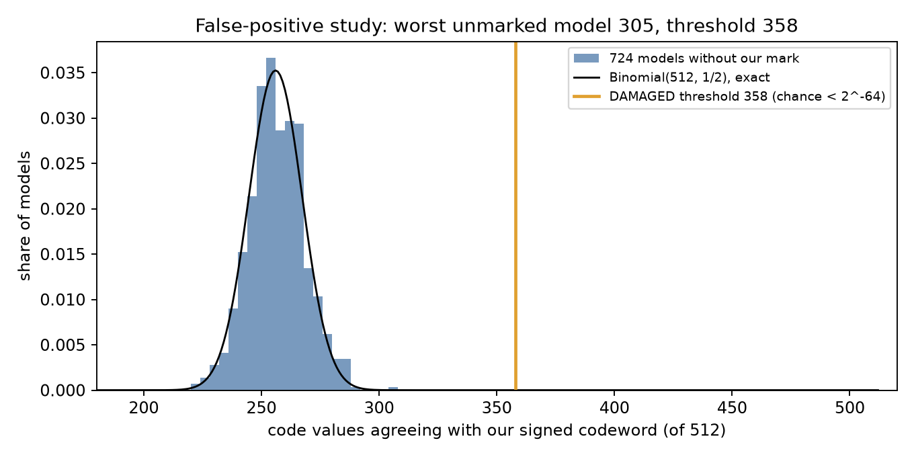
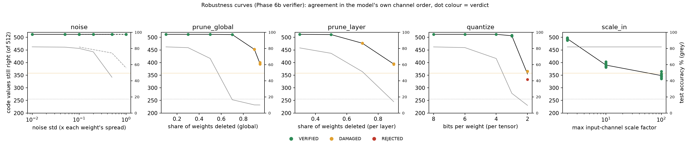
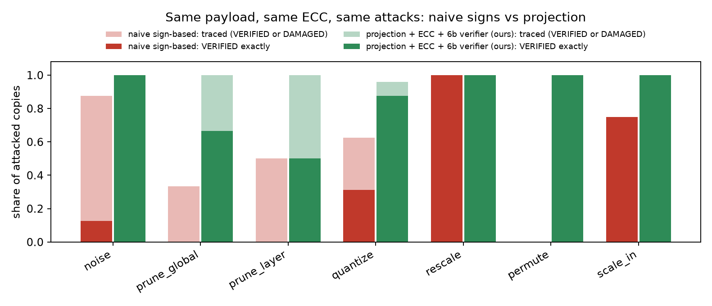

# Phase 7 results

Generated by `python -m experiments.phase7.robustness_report` from files already in the repo (no training). Projection numbers use the Phase 6b verifier.

## Clean CIFAR-10 test accuracy by seed

| seed | Baseline | BCE/RS16 | BCE/RS32 | Hinge 1.5/RS32 |
|---|---|---|---|---|
| 0 | 86.12% | 82.09% | 83.08% | 84.79% |
| 1 | 85.32% | 80.75% | 80.33% | 82.73% |
| 2 | 83.78% | 83.95% | 82.52% | 84.69% |
| 3 | 81.98% | — | 82.84% | 83.76% |
| 4 | 85.78% | — | 83.07% | 84.53% |

Mean differences below are paired with the baseline for each available seed.

- BCE/RS16 averaged 82.26% accuracy (-2.81 percentage points across 3 seeds).
- BCE/RS32 averaged 82.37% accuracy (-2.23 percentage points across 5 seeds).
- Hinge 1.5/RS32 averaged 84.10% accuracy (-0.50 percentage points across 5 seeds).

## Robustness across designs

A successful removal requires rejection with an accuracy drop of at most 5 percentage points. These evaluations cover seeds 0–2 and include the clean controls.

| Design | Copies | Verified | Damaged | Rejected | Successful removals | Removal configuration |
|---|---|---|---|---|---|---|
| BCE/RS32 | 252 | 231 | 20 | 1 | 0 | — |
| Hinge 1.5/RS32 | 252 | 233 | 13 | 6 | 3 | overwrite_512bit |
| BCE/RS16 | 252 | 240 | 12 | 0 | 0 | — |

## P7.1 Every trained watermark configuration

| ecc | wm_loss | n_bits | layer | lam | n_runs | mean_acc | mean_diff | decoded_errors_total | min_margin |
|---|---|---|---|---|---|---|---|---|---|
| rep2 | bce | 256 | features.6.0.weight | 20.0 | 2 | 0.8152 | -4.20 pts | 0 | 1.84 |
| rs16 | bce | 256 | features.6.0.weight | 20.0 | 3 | 0.8226 | -2.81 pts | 0 | 2.70 |
| rs32 | bce | 256 | features.4.0.weight | 1.0 | 1 | 0.8392 | -2.20 pts | 0 | 0.00 |
| rs32 | bce | 256 | features.4.0.weight | 5.0 | 1 | 0.8199 | -4.13 pts | 0 | 1.15 |
| rs32 | bce | 256 | features.4.0.weight | 20.0 | 1 | 0.7947 | -6.65 pts | 0 | 2.31 |
| rs32 | bce | 256 | features.6.0.weight | 1.0 | 1 | 0.8467 | -1.45 pts | 0 | 0.02 |
| rs32 | bce | 256 | features.6.0.weight | 5.0 | 1 | 0.8319 | -2.93 pts | 0 | 1.21 |
| rs32 | bce | 256 | features.6.0.weight | 20.0 | 5 | 0.8237 | -2.23 pts | 0 | 2.24 |
| rs32 | hinge1.5 | 256 | features.6.0.weight | 20.0 | 5 | 0.8410 | -0.50 pts | 0 | 1.50 |
| rs32 | hinge2.5 | 256 | features.6.0.weight | 20.0 | 1 | 0.8347 | -2.65 pts | 0 | 2.50 |

Only seed 0 exists for most lambda values, ECC off at 256 bits was never trained, and every model uses a 256-bit payload: the full sweeps are task P7.5 (Colab).

## P7.2 False-positive study

Decision rules and their exact false-accept bounds for a model that never carried our codeword (512 code values):

| Rule | Bound |
|---|---|
| VERIFIED, raw reading: Reed-Solomon decodes to exactly the signed 256-bit payload | negligible (a random word must land in the decoding radius of one specific codeword) |
| VERIFIED after undoing channel scaling: 64 positive factors fit all 512 signs | 2^-239.7 (Cover's function counting) |
| DAMAGED: at least 358 of 512 agree, counted in the model's own order | 2^-64.2 (exact binomial tail) |

Measured on every population of models without our mark:

| population | models | false_verified | false_damaged | max_agree | mean_agree |
|---|---|---|---|---|---|
| wrong key | 600 | 0 | 0 | 305 | 256.2 |
| baseline | 3 | 0 | 0 | 256 | 253.3 |
| baseline scrambled | 15 | 0 | 0 | 278 | 258.5 |
| mallory | 1 | 0 | 0 | 264 | 264.0 |
| mallory scrambled | 5 | 0 | 0 | 265 | 259.2 |
| random init | 100 | 0 | 0 | 289 | 256.1 |
| attacked baselines (Phase 6b) | 54 | 0 | 0 | — | — |

Worst agreement over 724 null models: **305 of 512** (threshold 358). 0 false VERIFIED, 0 false DAMAGED.

## P7.3 Robustness curves

Agreement with the signed codeword (in the model's own channel order) against attack strength; dot colour = verdict, grey = test accuracy. These curves show the original BCE/RS32 design. The verifier can reverse channel scaling before decoding.

## P7.4 Comparison with the naive sign-based scheme

Naive scheme (the project's first design): bit = sign of one key-chosen weight. Built as fairly as possible: same layer, same 256-bit signed payload, same rs32 codeword, same soft decoding and decision rule, the same weight attacks. The naive results cover 2 seeds with one draw per random attack. Projection results cover three seeds with three draws per random attack. Rates below give each attack configuration equal weight.

| | naive sign-based | projection (ours) |
|---|---|---|
| Accuracy cost of embedding | -0.09 pts (mean of 2 seeds) | −3.10 pts (paired, 3 seeds) |
| Attack types that removed it (model still useful) | 6: noise_carrier_s1, prune_global_0.5, permute_out_carrier, permute_in_carrier, permute_all, permute_scale_in_x10 | 0: none |
| Copies VERIFIED exactly, all attacks | 26% | 86% |
| Copies traced (VERIFIED or DAMAGED) | 61% | 99% |

| attack_id | naive_outcome | naive_verified | naive_detected | proj_outcome | proj_verified | proj_detected |
|---|---|---|---|---|---|---|
| noise_all_s0.01 | held | 100% | 100% | held | 100% | 100% |
| noise_all_s0.05 | held | 0% | 100% | held | 100% | 100% |
| noise_all_s0.1 | held | 0% | 100% | held | 100% | 100% |
| noise_all_s0.2 | held | 0% | 100% | held | 100% | 100% |
| noise_all_s0.5 | held | 0% | 100% | held | 100% | 100% |
| noise_carrier_s0.1 | held | 0% | 100% | held | 100% | 100% |
| noise_carrier_s0.5 | held | 0% | 100% | held | 100% | 100% |
| noise_carrier_s1 | removed | 0% | 0% | held | 100% | 100% |
| prune_global_0.1 | held | 0% | 100% | held | 100% | 100% |
| prune_global_0.3 | held | 0% | 100% | held | 100% | 100% |
| prune_global_0.5 | removed | 0% | 0% | held | 100% | 100% |
| prune_global_0.7 | ruined | 0% | 0% | held | 100% | 100% |
| prune_global_0.9 | ruined | 0% | 0% | held | 0% | 100% |
| prune_global_0.95 | ruined | 0% | 0% | held | 0% | 100% |
| prune_layer_0.3 | held | 0% | 100% | held | 100% | 100% |
| prune_layer_0.5 | held | 0% | 100% | held | 100% | 100% |
| prune_layer_0.7 | ruined | 0% | 0% | held | 0% | 100% |
| prune_layer_0.9 | ruined | 0% | 0% | held | 0% | 100% |
| half | held | 100% | 100% | held | 100% | 100% |
| quant_pt_8 | held | 50% | 100% | held | 100% | 100% |
| quant_pt_6 | held | 0% | 100% | held | 100% | 100% |
| quant_pt_4 | ruined | 0% | 0% | held | 100% | 100% |
| quant_pt_3 | ruined | 0% | 0% | held | 100% | 100% |
| quant_pt_2 | ruined | 0% | 0% | ruined | 0% | 67% |
| quant_pc_8 | held | 100% | 100% | held | 100% | 100% |
| quant_pc_4 | held | 0% | 100% | held | 100% | 100% |
| rescale_carrier_x2 | held | 100% | 100% | held | 100% | 100% |
| rescale_carrier_x10 | held | 100% | 100% | held | 100% | 100% |
| rescale_all_x10 | held | 100% | 100% | held | 100% | 100% |
| permute_out_carrier | removed | 0% | 0% | held | 100% | 100% |
| permute_in_carrier | removed | 0% | 0% | held | 100% | 100% |
| permute_all | removed | 0% | 0% | held | 100% | 100% |
| scale_in_carrier_x2 | held | 100% | 100% | held | 100% | 100% |
| scale_in_carrier_x10 | held | 100% | 100% | held | 100% | 100% |
| scale_in_carrier_x100 | held | 100% | 100% | held | 100% | 100% |
| permute_scale_in_x10 | removed | 0% | 0% | held | 100% | 100% |

## Paper figures and remaining work

Run `python -m experiments.phase7.paper_figures` to regenerate the eight 300-DPI PNGs. [Paper figures](../results/phase7/paper_figures/)

The paper covers SmallCNN on CIFAR-10. Future work includes 19 BCE runs (3 without ECC, 10 varying watermark strength, 6 varying payload length). The current data support a single-seed strength comparison and measured error correction under quantization. A matched payload-length comparison remains open.

The manuscript, three-minute demo and mentor Q&A remain to be prepared.
